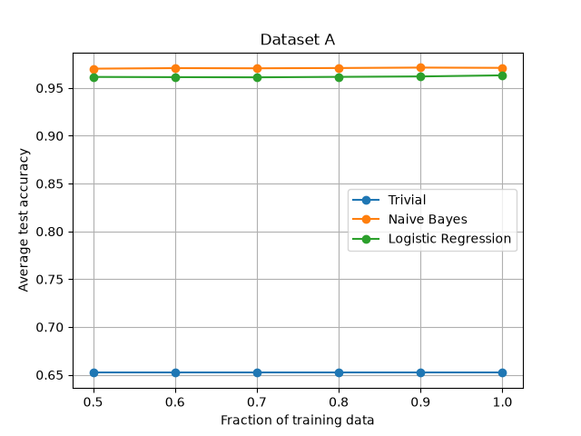
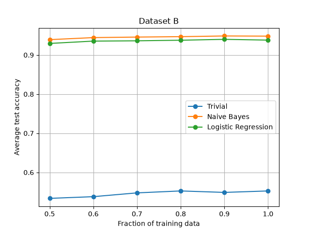
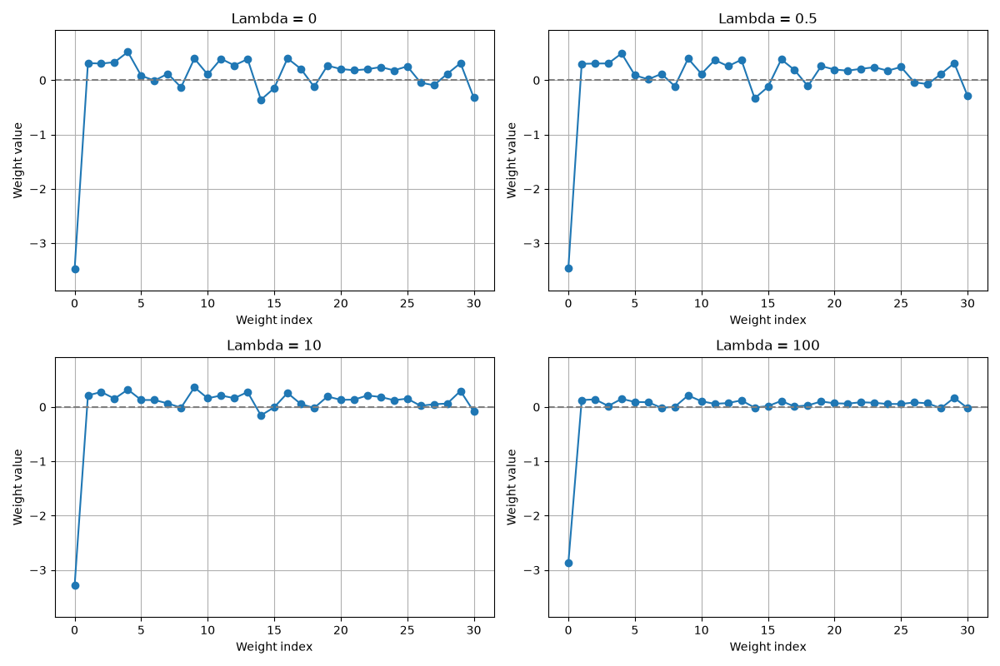

# Machine Learning Classification

Python implementations for Assignment 3 of the Introduction to Machine Learning course at the University of Crete.

## Exercises

**Exercise 1: Logistic Regression Theory**

Theoretical proof showing why logistic regression weights can grow without bound when the data are linearly separable.

**Exercise 2: Classifier Evaluation**

Comparison of Trivial Classifier, Naive Bayes and Logistic Regression using different training set sizes across two datasets.

Each experiment was repeated 100 times to calculate average accuracy.

**Dataset A**



**Dataset B**



**Exercise 3: L2 Regularization**

Investigation of how different regularization strengths (λ = 0, 0.5, 10, 100) affect logistic regression weights.



## Technologies

Python, NumPy, scikit-learn, Matplotlib, Mixed Naive Bayes and uv.

## Installation

```bash
uv sync
```

## Usage

Classifier evaluation:

```bash
uv run python run_analysis.py
```

Regularization experiment:

```bash
uv run python exercise3.py
```

## Author

Mohamed Nemri  
MSc Data Science and Machine Learning  
University of Crete